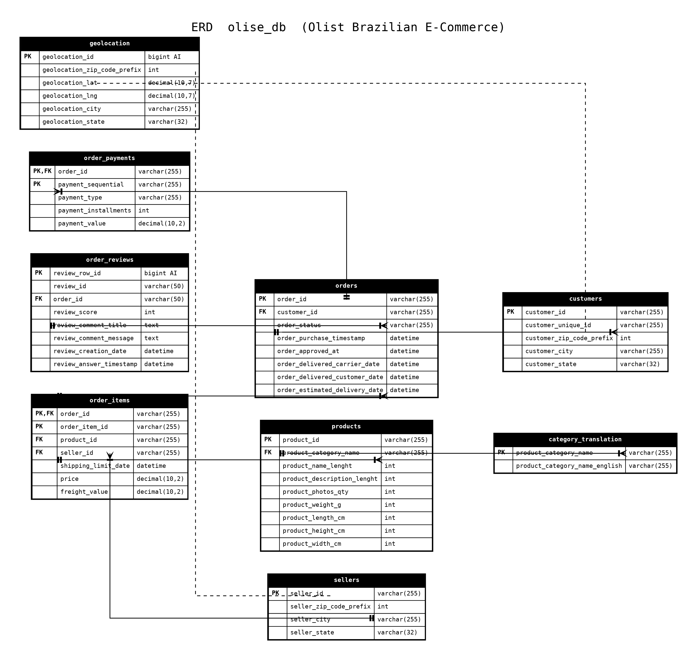
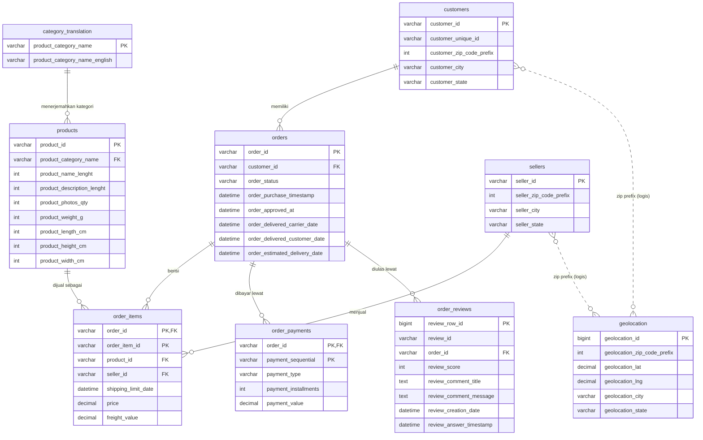

# Olist E-Commerce SQL Project (`olise_db`)

Proyek latihan SQL end-to-end menggunakan dataset **Brazilian E-Commerce Public Dataset by Olist**. Mulai dari membuat database dan skema tabel, mengimpor data, memeriksa kualitas data, menambahkan relasi *foreign key*, menjalankan analisis bisnis, membuat *view* siap pakai untuk dashboard, sampai memvalidasi bahwa angka di *view* sama dengan perhitungan manual.

- **Dataset:** [Brazilian E-Commerce Public Dataset by Olist (Kaggle)](https://www.kaggle.com/datasets/olistbr/brazilian-ecommerce)
- **DBMS:** MySQL 8.x
- **Tool:** DBeaver
- **Nama database:** `olise_db`
- **Bahasa:** SQL (dialek MySQL)

---

## Daftar Isi

1. [Gambaran Umum](#1-gambaran-umum)
2. [Tentang Dataset](#2-tentang-dataset)
3. [Struktur File](#3-struktur-file)
4. [ERD (Entity Relationship Diagram)](#4-erd-entity-relationship-diagram)
5. [Prasyarat](#5-prasyarat)
6. [Cara Menjalankan di DBeaver](#6-cara-menjalankan-di-dbeaver)
7. [Penjelasan Detail Tiap File SQL](#7-penjelasan-detail-tiap-file-sql)
   - [7.1 `1_olist_db_import_schema.sql`](#71-1_olist_db_import_schemasql)
   - [7.2 `2_olist_db_data_quality.sql`](#72-2_olist_db_data_qualitysql)
   - [7.3 `3_olist_db_foreign_key.sql`](#73-3_olist_db_foreign_keysql)
   - [7.4 `4_olist_db_analisis_bisnis.sql`](#74-4_olist_db_analisis_bisnissql)
   - [7.5 `5_olist_db_view.sql`](#75-5_olist_db_viewsql)
   - [7.6 `6_olist_db_validasi.sql`](#76-6_olist_db_validasisql)
8. [Kamus Data](#8-kamus-data)
9. [Keputusan Desain dan Catatan Teknis](#9-keputusan-desain-dan-catatan-teknis)
10. [Pemecahan Masalah (Troubleshooting)](#10-pemecahan-masalah-troubleshooting)
11. [Ide Pengembangan Lanjutan](#11-ide-pengembangan-lanjutan)
12. [Lisensi dan Kredit](#12-lisensi-dan-kredit)

---

## 1. Gambaran Umum

Proyek ini mensimulasikan alur kerja seorang analis data / data engineer pemula pada database relasional:

| Tahap | File | Tujuan |
|---|---|---|
| 1 | `1_olist_db_import_schema.sql` | Membuat database dan 9 tabel (tanpa relasi dulu) |
| 2 | `2_olist_db_data_quality.sql` | Memeriksa kualitas data setelah CSV diimpor |
| 3 | `3_olist_db_foreign_key.sql` | Membersihkan data yang bermasalah lalu memasang 7 foreign key |
| 4 | `4_olist_db_analisis_bisnis.sql` | 10 query analisis bisnis |
| 5 | `5_olist_db_view.sql` | 3 view untuk pelaporan / dashboard |
| 6 | `6_olist_db_validasi.sql` | Membuktikan angka view = angka manual |

Pendekatan utamanya: **impor dulu tanpa foreign key, periksa kualitas data, baru pasang relasi**. Dengan urutan ini, proses impor CSV di DBeaver tidak terhalang urutan tabel, dan masalah data (misalnya kategori produk yang tidak ada di tabel terjemahan) ditemukan lewat query pemeriksaan, bukan lewat pesan error yang membingungkan.

---

## 2. Tentang Dataset

Dataset Olist berisi sekitar 100 ribu pesanan dari marketplace Brasil (2016-2018) dalam bentuk beberapa file CSV yang saling terhubung.

| File CSV (Kaggle) | Tabel di proyek ini | Isi |
|---|---|---|
| `olist_customers_dataset.csv` | `customers` | Data pelanggan dan lokasi |
| `olist_orders_dataset.csv` | `orders` | Header pesanan, status, dan seluruh timestamp |
| `olist_order_items_dataset.csv` | `order_items` | Item per pesanan: produk, seller, harga, ongkir |
| `olist_order_payments_dataset.csv` | `order_payments` | Pembayaran per pesanan |
| `olist_order_reviews_dataset.csv` | `order_reviews` | Ulasan dan skor 1-5 |
| `olist_products_dataset.csv` | `products` | Atribut produk (kategori, berat, dimensi) |
| `olist_sellers_dataset.csv` | `sellers` | Data penjual |
| `product_category_name_translation.csv` | `category_translation` | Terjemahan kategori Portugis ke Inggris |
| `olist_geolocation_dataset.csv` | `geolocation` | Koordinat per prefix kode pos |

Angka acuan jumlah baris pada dataset Kaggle versi asli (hasil `A1` di file 2 bisa dibandingkan dengan ini; selisih kecil mungkin terjadi bila CSV Anda berbeda versi):

| Tabel | Perkiraan jumlah baris |
|---|---|
| `customers` | 99.441 |
| `orders` | 99.441 |
| `order_items` | 112.650 |
| `order_payments` | 103.886 |
| `order_reviews` | 99.224 |
| `products` | 32.951 |
| `sellers` | 3.095 |
| `category_translation` | 71 (menjadi 73 setelah file 3) |
| `geolocation` | sekitar 1.000.163 |

> Catatan: nama kolom `product_name_lenght` dan `product_description_lenght` memang salah ketik (*lenght*) dari dataset aslinya. Dipertahankan agar cocok dengan header CSV saat impor.

---

## 3. Struktur File

```text
.
├── README.md
├── erd_olise_db.png                    # ERD hitam putih
├── 1_olist_db_import_schema.sql        # DDL: database + tabel
├── 2_olist_db_data_quality.sql         # Pemeriksaan kualitas data
├── 3_olist_db_foreign_key.sql          # Cleaning + foreign key
├── 4_olist_db_analisis_bisnis.sql      # 10 analisis bisnis
├── 5_olist_db_view.sql                 # 3 view pelaporan
├── 6_olist_db_validasi.sql             # Validasi view vs manual
└── data/                               # (opsional) taruh 9 file CSV di sini
```

Urutan eksekusi **wajib berurutan 1 sampai 6**, dengan satu langkah manual di antara file 1 dan file 2: **impor CSV**.

---

## 4. ERD (Entity Relationship Diagram)



### Versi Mermaid (otomatis tampil di GitHub)



### Ringkasan relasi

| # | Tabel induk (1) | Tabel anak (N) | Kolom penghubung | Nama constraint |
|---|---|---|---|---|
| 1 | `customers` | `orders` | `customer_id` | `fk_orders_customers` |
| 2 | `orders` | `order_items` | `order_id` | `fk_order_items_orders` |
| 3 | `products` | `order_items` | `product_id` | `fk_order_items_products` |
| 4 | `sellers` | `order_items` | `seller_id` | `fk_order_items_sellers` |
| 5 | `orders` | `order_payments` | `order_id` | `fk_order_payments_orders` |
| 6 | `orders` | `order_reviews` | `order_id` | `fk_order_reviews_orders` |
| 7 | `category_translation` | `products` | `product_category_name` | `fk_products_category` |

Tabel `geolocation` **sengaja tidak diberi foreign key**. Kolom `geolocation_zip_code_prefix` tidak unik (satu prefix punya banyak titik koordinat), sehingga tidak bisa menjadi kolom yang direferensikan. Hubungannya dengan `customers` dan `sellers` hanya bersifat logis lewat kode pos (garis putus-putus di ERD).

Tip: DBeaver juga bisa membuat ERD otomatis. Setelah file 3 dijalankan, klik kanan database `olise_db` lalu pilih **View Diagram**, atau buka tab **ER Diagram** pada sebuah tabel. Cocok untuk mencocokkan dengan gambar di atas.

---

## 5. Prasyarat

- **MySQL 8.0 atau lebih baru.** File 4 memakai CTE (`WITH ... AS`) yang baru tersedia mulai MySQL 8.0 (MariaDB 10.2.1+).
- **DBeaver** (Community Edition cukup) dengan driver MySQL (DBeaver akan menawarkan unduh otomatis saat pertama membuat koneksi).
- **Dataset CSV** dari Kaggle (perlu akun Kaggle gratis).
- Ruang disk sekitar beberapa ratus MB (tabel `geolocation` paling besar).

---

## 6. Cara Menjalankan di DBeaver

### Langkah 1. Siapkan koneksi

1. Buka DBeaver, klik **Database > New Database Connection**, pilih **MySQL**.
2. Isi host (`localhost`), port (`3306`), user, dan password. Pada awal, kosongkan kolom database karena database dibuat oleh script.
3. Klik **Test Connection**, lalu **Finish**.

### Langkah 2. Jalankan file 1 (buat database dan tabel)

1. Klik kanan koneksi, **SQL Editor > Open SQL script**, lalu buka `1_olist_db_import_schema.sql`.
2. Jalankan **seluruh script** dengan **Alt + X** (*Execute SQL Script*). Jangan memakai `Ctrl + Enter` karena itu hanya menjalankan satu statement.
3. Klik kanan koneksi, **Refresh** (F5), agar `olise_db` muncul di navigator.

### Langkah 3. Impor 9 file CSV

Impor dilakukan per tabel: klik kanan tabel di navigator, **Import Data**, pilih **CSV**.

Pengaturan yang disarankan:

| Pengaturan | Nilai |
|---|---|
| Encoding | `UTF-8` |
| Delimiter | `,` |
| Header | **Top** (baris pertama adalah header) |
| Set empty strings to NULL | **Aktifkan** (penting untuk kolom tanggal yang kosong) |
| Timestamp format | `yyyy-MM-dd HH:mm:ss` |
| Batch size | dinaikkan (misal 1000-5000) agar impor `geolocation` tidak lama |

Hal-hal khusus yang perlu diperhatikan:

- **`geolocation`**: CSV tidak punya kolom `geolocation_id`. Karena kolom itu `AUTO_INCREMENT`, di halaman *column mapping* biarkan `geolocation_id` tidak dipetakan (*skip*).
- **`order_reviews`**: CSV tidak punya `review_row_id`. Perlakuan sama seperti di atas.
- **Pasangan nama kolom**: pastikan di *mapping* nama kolom CSV dan kolom tabel berstatus *existing*. Kolom `product_name_lenght` harus cocok dengan header CSV.
- Karena belum ada foreign key, **urutan impor bebas**. Namun urutan yang rapi (induk dulu) tetap membantu: `category_translation`, `customers`, `sellers`, `products`, `orders`, `order_items`, `order_payments`, `order_reviews`, `geolocation`.

### Langkah 4. Jalankan file 2 (data quality)

Buka `2_olist_db_data_quality.sql`, lalu jalankan **per blok** (sorot satu query lalu `Ctrl + Enter`) agar hasil tiap pemeriksaan terlihat jelas. Bandingkan hasil `A1` dengan [angka acuan](#2-tentang-dataset). Catat khususnya hasil **D7** (kategori produk yang tidak punya terjemahan) karena itu yang diperbaiki di file 3.

### Langkah 5. Jalankan file 3 (cleaning dan foreign key)

Jalankan seluruh script dengan **Alt + X**. Di bagian akhir ada query verifikasi yang menampilkan 7 foreign key. Bila 7 baris muncul, relasi sudah terpasang.

> **Jalankan file 3 hanya sekali.** Menjalankan ulang akan gagal pada `INSERT` kategori (duplikat primary key) dan pada `ADD CONSTRAINT` (constraint sudah ada). Lihat [Troubleshooting](#10-pemecahan-masalah-troubleshooting).

### Langkah 6. Jalankan file 4, 5, dan 6

- File 4: jalankan per query (`Ctrl + Enter`) untuk melihat tiap hasil analisis.
- File 5: jalankan seluruh script (`Alt + X`). Tiga view dibuat lalu diperiksa isinya.
- File 6: jalankan per query dan periksa apakah total di semua sumber sama.

---

## 7. Penjelasan Detail Tiap File SQL

### 7.1 `1_olist_db_import_schema.sql`

**Tujuan:** membuat database `olise_db` dan seluruh tabel. Skema dibuat **tanpa foreign key** dulu, tetapi sudah memakai *primary key* dan tipe data yang tepat.

| Tabel | Primary key | Catatan |
|---|---|---|
| `sellers` | `seller_id` | |
| `category_translation` | `product_category_name` | Tabel referensi untuk terjemahan kategori |
| `geolocation` | `geolocation_id` (`BIGINT AUTO_INCREMENT`) | *Surrogate key* karena data asli tidak punya kolom unik |
| `customers` | `customer_id` | `customer_id` unik per pesanan; `customer_unique_id` mengidentifikasi orang yang sama |
| `products` | `product_id` | |
| `orders` | `order_id` | Lima kolom `DATETIME` untuk seluruh jejak waktu pesanan |
| `order_items` | **Composite**: (`order_id`, `order_item_id`) | Satu pesanan bisa berisi banyak item |
| `order_reviews` | `review_row_id` (`BIGINT AUTO_INCREMENT`) | Surrogate key, karena `review_id` pada data asli ternyata tidak unik |
| `order_payments` | **Composite**: (`order_id`, `payment_sequential`) | Satu pesanan bisa dibayar dengan beberapa metode/cicilan |

Tipe data penting:

- Uang memakai `DECIMAL(10,2)` (bukan `FLOAT`) agar penjumlahan tidak mengalami galat pembulatan.
- Koordinat memakai `DECIMAL(10,7)` (presisi sekitar 1 cm).
- `review_comment_title` dan `review_comment_message` memakai `TEXT` karena panjangnya bervariasi.

---

### 7.2 `2_olist_db_data_quality.sql`

**Tujuan:** memastikan data hasil impor layak sebelum relasi dipasang. Dikelompokkan dalam blok huruf:

| Blok | Pemeriksaan | Interpretasi hasil yang sehat |
|---|---|---|
| **A1** | Jumlah baris seluruh 9 tabel (digabung `UNION ALL`) | Sesuai angka acuan; tidak ada tabel kosong |
| **B1-B5** | `COUNT(*)` vs `COUNT(kolom)` vs `COUNT(DISTINCT kolom)` pada primary key | Ketiganya sama berarti ID terisi semua dan unik |
| **B6, B7** | Duplikasi composite key `order_items` dan `order_payments` | Hasil kosong (tidak ada baris) |
| **B8** | Duplikasi `review_id` di `order_reviews` | Pada dataset ini **ada** duplikasi; itulah alasan tabel memakai `review_row_id` |
| **C1-C7** | Hitung `NULL` pada kolom-kolom kunci tiap tabel | `NULL` pada kolom ID kunci harus 0. `NULL` pada kategori produk wajar ada |
| **D1-D6** | *Orphan check*: baris anak yang induknya tidak ada (LEFT JOIN ... IS NULL) | Semua harus 0, kalau tidak foreign key akan gagal dipasang |
| **D7** | Kategori di `products` yang tidak ada di `category_translation` | Menampilkan kategori bermasalah; dibereskan di file 3 |
| **E1** | Skor review di luar 1-5 atau `NULL` | 0 |
| **E2-E4** | Harga/ongkir/pembayaran negatif, cicilan negatif | 0 |
| **E5** | `order_approved_at` lebih awal dari `order_purchase_timestamp` | 0 |
| **(tanpa label)** | Tiga cek logika tanggal pengiriman dan satu cek status `delivered` tanpa tanggal terima | Perhatikan hasilnya; nilai > 0 menandakan anomali data yang perlu disikapi saat analisis |
| **G1** | Prefix kode pos dengan lebih dari satu baris di `geolocation` | Banyak; membuktikan prefix tidak bisa jadi primary key |
| **G2** | Koordinat di luar rentang geografis | 0 |

Teknik SQL yang dipakai:

- `SUM(kolom IS NULL)` memanfaatkan sifat MySQL yang menganggap hasil boolean sebagai 1/0, jadi dapat dijumlahkan untuk menghitung `NULL`.
- Pola *anti-join* (`LEFT JOIN ... WHERE tabel_induk.kolom IS NULL`) untuk mencari data yatim.
- `UNION ALL` untuk menggabungkan beberapa `COUNT(*)` menjadi satu tabel ringkas.

> Blok pemeriksaan dilabeli A, B, C, D, E, lalu G. Blok **F** tidak ada; empat query tanggal setelah E5 tidak diberi label huruf.

---

### 7.3 `3_olist_db_foreign_key.sql`

**Tujuan:** merapikan data lalu memasang 7 foreign key. Urutannya penting:

1. **Foreign key 1-6** dipasang lebih dulu karena data sudah lolos pemeriksaan D1-D6.
2. **Cleaning kategori kosong:**
   ```sql
   UPDATE products
   SET product_category_name = NULL
   WHERE TRIM(product_category_name) = '';
   ```
   String kosong (`''`) bukan `NULL`, sehingga akan dianggap sebagai nilai yang harus ada di tabel referensi dan membuat FK gagal. Mengubahnya menjadi `NULL` membuatnya lolos (kolom FK boleh `NULL`).
3. **Menambah dua kategori yang hilang** ke `category_translation`:

   | `product_category_name` (Portugis) | `product_category_name_english` |
   |---|---|
   | `portateis_cozinha_e_preparadores_de_alimentos` | `portable_kitchen_food_processors` |
   | `pc_gamer` | `pc_gamer` |

   Dua kategori ini dipakai oleh `products` tetapi tidak ada di file terjemahan bawaan Kaggle (inilah yang ditemukan oleh pemeriksaan **D7**). Terjemahan Inggrisnya diisi manual oleh pembuat proyek.
4. **Foreign key 7** (`products` ke `category_translation`) dipasang terakhir setelah data kategori lengkap.
5. **Verifikasi** lewat `information_schema.KEY_COLUMN_USAGE`: menampilkan tabel, kolom, nama constraint, serta tabel dan kolom yang direferensikan. Harus muncul 7 baris.

---

### 7.4 `4_olist_db_analisis_bisnis.sql`

Sepuluh query analisis. Kecuali disebutkan lain, analisis penjualan hanya memakai pesanan berstatus **`delivered`**, dan "nilai penjualan" berarti **jumlah `price` item (tidak termasuk ongkir)**.

| # | Analisis | Tabel yang dipakai | Logika utama | Catatan |
|---|---|---|---|---|
| 1 | **Tren penjualan bulanan** | `orders`, `order_items` | `DATE_FORMAT(order_delivered_customer_date, '%Y-%m')`, `COUNT(DISTINCT order_id)`, `SUM(price)` | Bulan dihitung dari **tanggal barang diterima**, bukan tanggal beli |
| 2 | **Kategori dengan penjualan terbesar** | + `products`, `category_translation` | `COALESCE(nama_inggris, nama_portugis, 'Uncategorized')` | `LEFT JOIN` ke terjemahan agar produk tanpa terjemahan tidak hilang |
| 3 | **Penjualan per negara bagian pelanggan** | `customers`, `orders`, `order_items` | `GROUP BY customer_state` | Lokasi yang dipakai adalah lokasi pembeli |
| 4 | **Rata-rata waktu pengiriman per negara bagian** | `orders`, `customers` | CTE `waktu_kirim`, `DATEDIFF(diterima, dibeli)`, `AVG` | Dalam satuan hari, dibulatkan 2 desimal |
| 5 | **Persentase keterlambatan per negara bagian** | `orders`, `customers` | `SUM(CASE WHEN diterima > estimasi THEN 1 ELSE 0 END) / COUNT(*)` | Terlambat = diterima setelah tanggal estimasi |
| 6 | **Jumlah pesanan per status** | `orders` | `COUNT(*)` dan persentase terhadap seluruh pesanan lewat subquery | Mencakup **semua** status, bukan hanya `delivered` |
| 7 | **Top 20 seller** | `sellers`, `order_items`, `orders` | `SUM(price)` per seller, `LIMIT 20` | `jumlah_pesanan` memakai `DISTINCT`, `jumlah_item` memakai `COUNT(*)` |
| 8 | **Metode pembayaran** | `order_payments`, `orders` | Hitung transaksi, pesanan unik, total, dan rata-rata per `payment_type` | Memakai `payment_value`, jadi sudah termasuk ongkir/cicilan |
| 9 | **Distribusi skor ulasan** | `order_reviews` | Jumlah dan persentase tiap skor 1-5 | Data di luar 1-5 disaring |
| 10 | **Hubungan keterlambatan dan skor ulasan** | `orders`, `order_reviews` | Dua CTE: status ketepatan waktu per pesanan, skor rata-rata per pesanan; lalu `JOIN` | Skor dirata-ratakan per pesanan lebih dulu agar pesanan dengan banyak ulasan tidak dihitung ganda |

Poin teknik yang patut dipahami:

- **`COUNT(DISTINCT order_id)` vs `COUNT(*)`** pada join dengan `order_items`: satu pesanan dapat memiliki banyak item, sehingga `COUNT(*)` menghitung item sedangkan `COUNT(DISTINCT ...)` menghitung pesanan.
- **`GROUP BY` dengan alias** (query 2 memakai `GROUP BY kategori`) diperbolehkan di MySQL.
- **Query 10** memperlihatkan pola penting: *agregasi dulu sebelum join* untuk mencegah *fan-out* (baris menggandakan diri).
- **Perbedaan penyebut:** query 5 membagi dengan jumlah pesanan terkirim, sedangkan query 6 membagi dengan seluruh pesanan. Keduanya benar untuk pertanyaannya masing-masing, tetapi jangan dibandingkan langsung.

---

### 7.5 `5_olist_db_view.sql`

Membuat tiga *view* (`CREATE OR REPLACE VIEW`) sebagai lapisan siap pakai untuk dashboard (Power BI, Tableau, Looker Studio, Metabase, dan sebagainya). Pembuatan ulang aman dilakukan berkali-kali.

| View | Isi | Kolom |
|---|---|---|
| `vw_monthly_sales` | Tren bulanan | `bulan`, `jumlah_pesanan`, `nilai_penjualan` |
| `vw_category_sales` | Penjualan per kategori | `kategori`, `jumlah_pesanan`, `jumlah_item`, `nilai_penjualan` |
| `vw_state_sales_delivery` | Penjualan dan kinerja pengiriman per negara bagian | `negara_bagian`, `jumlah_pesanan`, `nilai_penjualan`, `rata_rata_hari_pengiriman`, `persentase_terlambat` |

Desain yang layak dicatat:

- **`vw_monthly_sales`** menambah filter `order_delivered_customer_date IS NOT NULL`. Pesanan `delivered` tanpa tanggal terima otomatis tidak masuk, karena tidak punya bulan. Lihat catatan [di bagian validasi](#76-6_olist_db_validasisql).
- **`vw_category_sales`** menambah kolom `jumlah_item` dibanding query analisis aslinya, dan `GROUP BY` memakai ekspresi `COALESCE` penuh (bukan alias) agar portabel ke DBMS lain.
- **`vw_state_sales_delivery`** memakai **dua subquery terpisah** lalu `LEFT JOIN`:
  - subquery `sales` menghitung penjualan (join ke `order_items`, satu baris per item),
  - subquery `delivery` menghitung rata-rata hari dan persentase terlambat **tanpa** join ke `order_items`.

  Alasannya: bila rata-rata pengiriman dihitung pada join yang sudah melibatkan `order_items`, pesanan berisi banyak item akan terhitung berkali-kali sehingga rata-ratanya bias. Memisahkan dua subquery menjaga setiap pesanan tepat satu kali di perhitungan pengiriman.
- Persentase terlambat dihitung dengan `100.0 * AVG(CASE WHEN ... THEN 1.0 ELSE 0.0 END)`, yaitu rata-rata dari indikator 1/0 (setara dengan proporsi).
- View tidak memakai `ORDER BY` di dalam definisinya (praktik yang baik); pengurutan dilakukan saat view dipanggil, seperti pada bagian "cek hasil view" di akhir file.

---

### 7.6 `6_olist_db_validasi.sql`

**Tujuan:** membuktikan bahwa angka di view sama dengan angka yang dihitung langsung dari tabel dasar (*reconciliation*).

| Validasi | Isi | Yang diharapkan |
|---|---|---|
| 1 | Total pesanan, item, dan nilai penjualan `delivered` langsung dari tabel | Angka patokan (*ground truth*) |
| 2 | Total dari `vw_monthly_sales` | Mendekati patokan; bisa sedikit lebih kecil (lihat catatan) |
| 3 | Total dari `vw_category_sales` | **Sama persis** dengan patokan |
| 4 | Total dari `vw_state_sales_delivery` | **Sama persis** dengan patokan |
| 5 | Membandingkan patokan, view kategori, dan view negara bagian dalam satu tabel | Tiga baris dengan nilai identik |
| 6 | 10 kategori teratas | Pemeriksaan kewajaran (*sanity check*) |
| 7 | Negara bagian berurut dari persentase terlambat tertinggi | Pemeriksaan kewajaran |
| 8 | Jumlah baris tiap view | Bukan 0; `vw_state_sales_delivery` seharusnya sebanyak negara bagian pelanggan |

**Catatan tentang validasi 2.** Script sudah memberi komentar bahwa `SUM(jumlah_pesanan)` dari view bulanan tidak serta-merta sama dengan jumlah pesanan unik. Pada praktiknya, karena setiap pesanan hanya punya satu tanggal terima, satu pesanan hanya muncul di satu bulan, sehingga penjumlahan itu seharusnya setara dengan jumlah pesanan unik **yang punya tanggal terima**. Selisih terhadap validasi 1 (jika ada) muncul karena `vw_monthly_sales` mengecualikan pesanan `delivered` tanpa tanggal terima, sedangkan validasi 1, view kategori, dan view negara bagian tidak mengecualikannya. Jika ingin cocok persis, bandingkan juga dengan query manual yang memakai filter `order_delivered_customer_date IS NOT NULL`.

---

## 8. Kamus Data

### `customers`
| Kolom | Tipe | Keterangan |
|---|---|---|
| `customer_id` (PK) | varchar(255) | ID pelanggan **per pesanan** (berubah tiap order) |
| `customer_unique_id` | varchar(255) | ID unik orang sebenarnya; dipakai untuk analisis pelanggan berulang |
| `customer_zip_code_prefix` | int | 5 digit awal kode pos |
| `customer_city` | varchar(255) | Kota |
| `customer_state` | varchar(32) | Singkatan negara bagian Brasil (SP, RJ, MG, dst.) |

### `orders`
| Kolom | Tipe | Keterangan |
|---|---|---|
| `order_id` (PK) | varchar(255) | ID pesanan |
| `customer_id` (FK) | varchar(255) | Ke `customers` |
| `order_status` | varchar(255) | `delivered`, `shipped`, `canceled`, `unavailable`, `invoiced`, `processing`, `created`, `approved` |
| `order_purchase_timestamp` | datetime | Waktu pembelian |
| `order_approved_at` | datetime | Waktu pembayaran disetujui |
| `order_delivered_carrier_date` | datetime | Waktu diserahkan ke kurir |
| `order_delivered_customer_date` | datetime | Waktu diterima pelanggan |
| `order_estimated_delivery_date` | datetime | Estimasi tanggal terima yang dijanjikan |

### `order_items`
| Kolom | Tipe | Keterangan |
|---|---|---|
| `order_id` (PK, FK) | varchar(255) | Ke `orders` |
| `order_item_id` (PK) | varchar(255) | Nomor urut item dalam pesanan (1, 2, 3, ...) |
| `product_id` (FK) | varchar(255) | Ke `products` |
| `seller_id` (FK) | varchar(255) | Ke `sellers` |
| `shipping_limit_date` | datetime | Batas waktu seller menyerahkan ke kurir |
| `price` | decimal(10,2) | Harga item |
| `freight_value` | decimal(10,2) | Ongkir item |

### `order_payments`
| Kolom | Tipe | Keterangan |
|---|---|---|
| `order_id` (PK, FK) | varchar(255) | Ke `orders` |
| `payment_sequential` (PK) | varchar(255) | Urutan pembayaran bila memakai lebih dari satu metode |
| `payment_type` | varchar(255) | Misal `credit_card`, `boleto`, `voucher`, `debit_card` |
| `payment_installments` | int | Jumlah cicilan |
| `payment_value` | decimal(10,2) | Nilai pembayaran |

### `order_reviews`
| Kolom | Tipe | Keterangan |
|---|---|---|
| `review_row_id` (PK) | bigint auto_increment | Kunci buatan (surrogate) |
| `review_id` | varchar(50) | ID ulasan dari sumber (tidak unik) |
| `order_id` (FK) | varchar(50) | Ke `orders` |
| `review_score` | int | Skor 1-5 |
| `review_comment_title` | text | Judul komentar (sering kosong) |
| `review_comment_message` | text | Isi komentar (sering kosong; bahasa Portugis) |
| `review_creation_date` | datetime | Tanggal survei dikirim |
| `review_answer_timestamp` | datetime | Waktu survei dijawab |

### `products`
| Kolom | Tipe | Keterangan |
|---|---|---|
| `product_id` (PK) | varchar(255) | ID produk |
| `product_category_name` (FK) | varchar(255) | Kategori (Portugis) ke `category_translation` |
| `product_name_lenght` | int | Jumlah karakter nama produk |
| `product_description_lenght` | int | Jumlah karakter deskripsi |
| `product_photos_qty` | int | Jumlah foto |
| `product_weight_g` | int | Berat (gram) |
| `product_length_cm`, `product_height_cm`, `product_width_cm` | int | Dimensi (cm) |

### `sellers`
| Kolom | Tipe | Keterangan |
|---|---|---|
| `seller_id` (PK) | varchar(255) | ID penjual |
| `seller_zip_code_prefix` | int | Prefix kode pos |
| `seller_city` | varchar(255) | Kota |
| `seller_state` | varchar(32) | Negara bagian |

### `category_translation`
| Kolom | Tipe | Keterangan |
|---|---|---|
| `product_category_name` (PK) | varchar(255) | Nama kategori Portugis |
| `product_category_name_english` | varchar(255) | Nama kategori Inggris |

### `geolocation`
| Kolom | Tipe | Keterangan |
|---|---|---|
| `geolocation_id` (PK) | bigint auto_increment | Kunci buatan |
| `geolocation_zip_code_prefix` | int | Prefix kode pos (tidak unik) |
| `geolocation_lat`, `geolocation_lng` | decimal(10,7) | Koordinat |
| `geolocation_city`, `geolocation_state` | varchar | Kota dan negara bagian |

---

## 9. Keputusan Desain dan Catatan Teknis

1. **Impor dulu, relasi belakangan.** Memasang FK sebelum impor memaksa urutan impor yang ketat dan membuat error sulit dilacak. Dengan pola ini, masalah data ditemukan lewat query pemeriksaan di file 2.
2. **Surrogate key untuk tabel tanpa kunci alami** (`geolocation`, `order_reviews`). Data `review_id` terbukti duplikat, jadi tidak layak menjadi primary key.
3. **Composite primary key** pada `order_items` dan `order_payments` mencerminkan struktur data aslinya.
4. **`DECIMAL` untuk uang**, bukan `FLOAT`/`DOUBLE`.
5. **Definisi "penjualan"** di seluruh proyek: `SUM(order_items.price)` pesanan `delivered`. Ongkir (`freight_value`) tidak termasuk. Ini berbeda dengan `SUM(order_payments.payment_value)` (query 8) yang sudah memuat ongkir, sehingga totalnya tidak akan sama dengan penjualan.
6. **Dasar bulan pada tren penjualan** adalah tanggal terima, bukan tanggal beli. Bila ingin tren berdasarkan waktu transaksi, ganti dengan `order_purchase_timestamp`.
7. **Hindari fan-out saat join.** Contohnya agregasi per pesanan sebelum join (query 10) dan pemisahan subquery pada `vw_state_sales_delivery`.
8. **Tipe kolom ID urutan** (`order_item_id`, `payment_sequential`) disimpan sebagai `varchar`. Akibatnya bila diurutkan, `'10'` muncul sebelum `'2'` (urutan teks). Gunakan `CAST(... AS UNSIGNED)` bila perlu urutan numerik.
9. **Konsistensi panjang `varchar` ID.** `order_reviews` memakai `varchar(50)` untuk `review_id` dan `order_id`, sedangkan tabel lain `varchar(255)`. Tidak menimbulkan masalah pada FK, tetapi bisa diseragamkan.
10. **Nama database `olise_db`** (bukan `olist_db`) dipertahankan sesuai script. Semua file memakai `USE olise_db;`, jadi cukup diubah di satu tempat bila ingin mengganti nama.
11. **Satu pelanggan, banyak `customer_id`.** Proyek ini menghitung per `customer_id` (per pesanan). Analisis retensi atau pelanggan berulang harus memakai `customer_unique_id`.

---

## 10. Pemecahan Masalah (Troubleshooting)

| Gejala | Kemungkinan penyebab | Solusi |
|---|---|---|
| Hanya satu query yang jalan saat menjalankan script | Memakai `Ctrl + Enter` | Pakai **Alt + X** untuk seluruh script |
| `Unknown database 'olise_db'` | File 1 belum dijalankan atau navigator belum di-refresh | Jalankan file 1, lalu tekan F5 pada koneksi |
| Impor tanggal gagal / `Incorrect datetime value` | Format tanggal atau string kosong tidak dikonversi | Aktifkan *Set empty strings to NULL* dan set format `yyyy-MM-dd HH:mm:ss` |
| Teks ulasan berantakan | Encoding bukan UTF-8 | Pilih encoding `UTF-8` saat impor |
| Impor `geolocation` sangat lambat | Batch size kecil, satu baris per insert | Naikkan *batch size*; sabar, tabel sekitar 1 juta baris |
| Error `Cannot add or update a child row: a foreign key constraint fails` (file 3) | Ada data yatim yang belum dibersihkan | Cek ulang blok **D1-D7** di file 2, perbaiki datanya, jalankan ulang constraint yang gagal |
| `Duplicate entry ... for key 'category_translation.PRIMARY'` | File 3 dijalankan lebih dari sekali | Lewati `INSERT` kategori (sudah masuk) |
| `Duplicate foreign key constraint name` | Constraint sudah terpasang | Lewati `ALTER TABLE` yang sudah berhasil, atau `ALTER TABLE ... DROP FOREIGN KEY nama` lalu pasang ulang |
| `You have an error in your SQL syntax` di query ber-`WITH` | MySQL di bawah 8.0 | Upgrade ke MySQL 8.x |
| `Incorrect string value` / karakter aneh pada nama kota | Collation database tidak mendukung karakter beraksen | Gunakan `utf8mb4` pada database/tabel |
| Total `vw_monthly_sales` sedikit di bawah total manual | Pesanan `delivered` tanpa tanggal terima dikecualikan | Wajar; lihat [catatan validasi 2](#76-6_olist_db_validasisql) |

Untuk mengulang dari awal: `DROP DATABASE olise_db;` lalu jalankan kembali dari file 1.

---

## 11. Ide Pengembangan Lanjutan

- Analisis **pelanggan berulang** memakai `customer_unique_id` (retensi, RFM).
- Analisis **pertumbuhan MoM / YoY** dengan fungsi window `LAG()`.
- Penambahan **indeks** pada kolom yang sering di-join/filter (`orders.order_status`, `orders.customer_id`, `order_items.product_id`, `order_items.seller_id`) lalu bandingkan `EXPLAIN` sebelum dan sesudah.
- Hubungkan `geolocation` (agregasi rata-rata koordinat per prefix) untuk visualisasi peta.
- Hitung **rata-rata nilai pesanan (AOV)** dan **kontribusi ongkir** terhadap harga.
- Analisis **kinerja seller**: waktu serah ke kurir vs `shipping_limit_date`, skor ulasan per seller.
- Hubungkan view ke **Power BI / Tableau / Looker Studio / Metabase** untuk dashboard.
- Bungkus seluruh pipeline menjadi satu script atau Makefile (impor memakai `LOAD DATA LOCAL INFILE`).

---

## 12. Lisensi dan Kredit

- **Dataset:** dibuat dan dipublikasikan oleh **Olist** di Kaggle (*Brazilian E-Commerce Public Dataset by Olist*), dengan lisensi **CC BY-NC-SA 4.0**. Hak data tetap pada pemiliknya; proyek ini hanya untuk tujuan belajar dan non-komersial.
- **Script SQL dan dokumentasi** pada repositori ini adalah hasil latihan pribadi. Silakan dipakai ulang untuk belajar dengan menyebutkan sumber.
